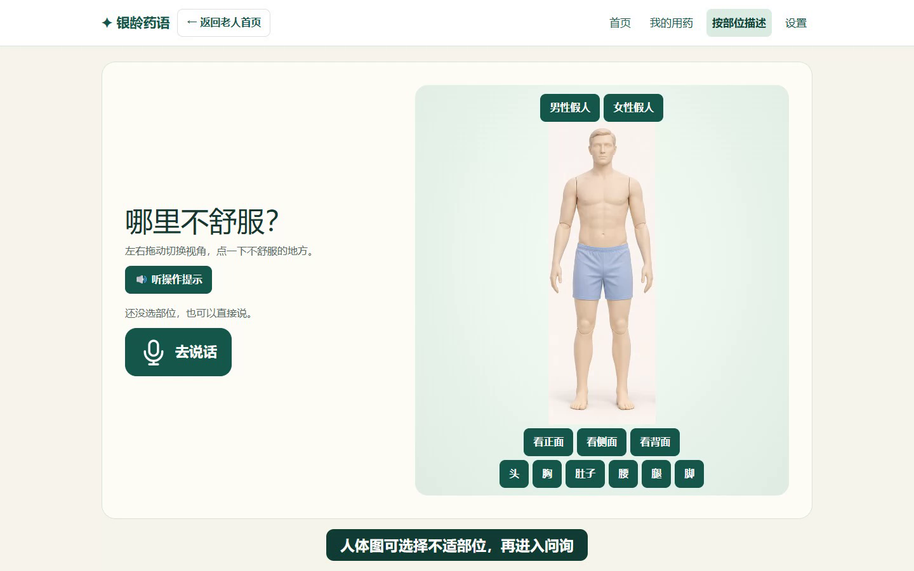
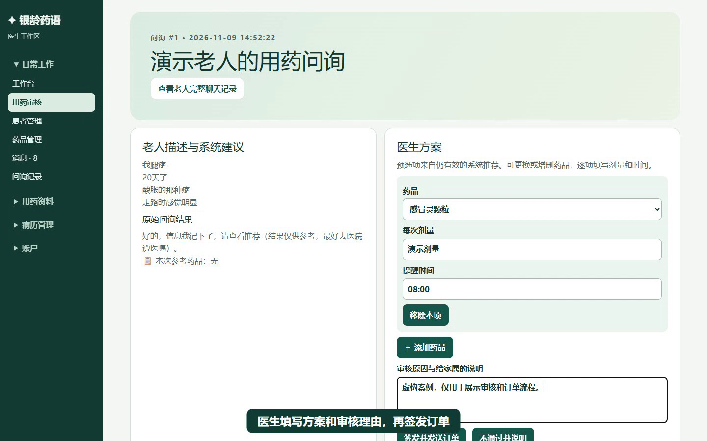
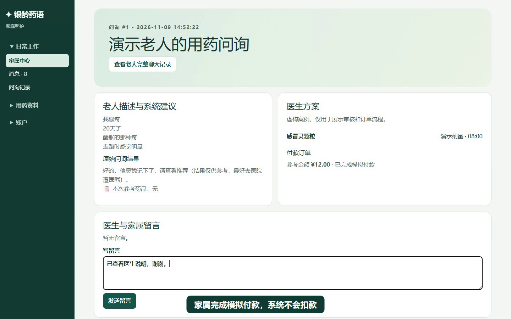

# 银铃药语

基于 RAG 与大模型的农村独居老人语音导诊系统 · v7 毕业设计作品展示

系统围绕一次问询组织老人、村医和家属的操作。老人通过语音或文字描述不适，也可以先在人体图上选择部位。医生查看主诉和聊天记录，审核方案并写明理由。家属跟进审核结果、留言并确认模拟订单，系统随后生成用药计划。

[下载功能演示录屏（约 48 秒）](media/demo.webm)

录屏使用虚构账号和病例，问询演示采用规则模式。画面中的药品和订单仅用于演示业务流程。

## 三端界面

| 老人端 · 人体部位选择 | 医生端 · 用药审核 | 家属端 · 订单与留言 |
| --- | --- | --- |
|  |  |  |

## 设计与验证

- **前端与服务**　HTML、CSS、JavaScript 和 Flask。页面通过 HTTP 提交问询，后端执行角色校验、读取数据并返回结果。
- **多轮问询**　同次会话传递前几轮消息。用「腿疼 → 20 天了 → 酸胀」检查上下文是否传到模型，并测试新会话是否隔离。
- **检索与模型**　使用 Chroma 检索药品资料，SQLite 保存业务数据。可配置智谱或 DeepSeek，未配置时可使用规则问询。
- **病历资料**　老人或家属提交图片或 PDF，关联医生核对归档。用虚构数据验证过上传、归档和未关联账号的访问限制。

## 权利说明

本仓库用于作品展示。作者对自有代码和展示材料保留权利。商业使用请事先取得相应权利人的许可。
